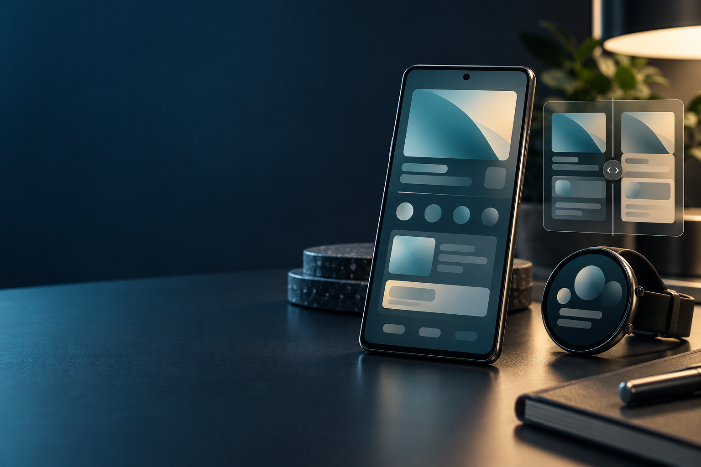
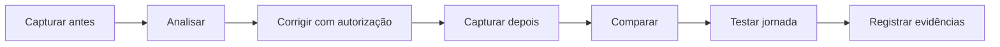
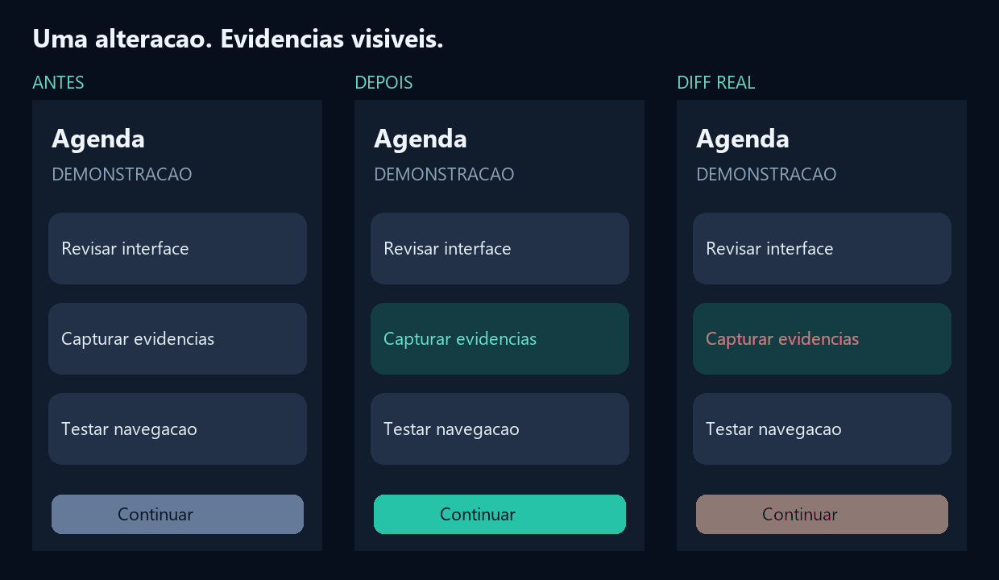

<div align="center">

# Impeccable Mobile Studio
### Da interface na tela à melhoria comprovada.

Capturas reais · Revisão por IA · Comparação visual · Jornadas Android




[Instalação](#instalação-no-windows) · [Manual](#manual-dos-comandos) · [Revisões](#usando-com-um-agente) · [Problemas](#solução-de-problemas)
</div>

> Projeto independente que complementa o [Impeccable oficial](https://github.com/pbakaus/impeccable), de Paul Bakaus. Não inclui seu motor nem representa uma versão oficial. A capa é uma ilustração conceitual gerada por IA, não uma captura de software entregue.

## O que é

Um kit para agentes de IA analisarem e melhorarem interfaces Android com evidências. A skill orienta o agente; scripts locais capturam a tela, comparam imagens e executam jornadas. As referências contemplam Compose, Flutter, React Native e Wear OS. Não há automação iOS implementada.

| Parte | Responsabilidade |
|---|---|
| Skill `impeccable-mobile` | Organizar a revisão e aplicar orientações da plataforma |
| Impeccable oficial, separado | Comandos de direção de arte e análise de design |
| Python + ADB | Screenshot PNG, metadados e hierarquia XML opcional |
| Pillow | Diff visual e métricas de pixels |
| Maestro CLI | Jornadas YAML locais no app instalado |
| scrcpy, opcional | Espelhamento e controle do Android |

## Como funciona



**Diff de pixels não é nota de qualidade.** A interpretação estética cabe ao agente; a aprovação permanece com a pessoa responsável. Os comandos de design dependem do Impeccable oficial.

## Instalação no Windows

### 1. Pré-requisitos

| Ferramenta | Uso |
|---|---|
| [Git](https://git-scm.com/downloads) | Clonar e atualizar |
| [Python 3.10+](https://www.python.org/downloads/) e pip | CLI e Pillow |
| [Android Platform Tools](https://developer.android.com/tools/releases/platform-tools) | ADB para capturas e inspeção |
| [Node.js](https://nodejs.org/) com npx | Instalador do Impeccable oficial |
| [Maestro](https://docs.maestro.dev/maestro-cli/how-to-install-maestro-cli) e Java compatível | Opcional, para jornadas |
| [scrcpy](https://github.com/Genymobile/scrcpy) | Opcional, para espelhamento |

As exigências de Java dependem da versão instalada do Maestro. Os instaladores destas ferramentas são separados do kit.

### 2. Baixar e preparar o kit

```powershell
Set-Location "$HOME\projetos"
git clone https://github.com/playertwo1/Impeccable-Mobile-Studio.git
Set-Location Impeccable-Mobile-Studio
py -m venv .venv
& .\.venv\Scripts\python.exe -m pip install -r requirements.txt
& .\.venv\Scripts\python.exe scripts/mobile.py doctor
```

Se o repositório estiver privado, autentique-se com uma conta autorizada. Alternativamente, use **Code → Download ZIP**, extraia e abra o terminal na pasta.

### 3. Instalar no projeto do aplicativo

Substitua `MeuApp` pelo caminho real. A skill é instalada por projeto.

```powershell
$Kit = "$HOME\projetos\Impeccable-Mobile-Studio"
$App = "$HOME\projetos\MeuApp"
Set-Location $App
npx impeccable install
& "$Kit\scripts\install.ps1" -ProjectPath $App -Providers @('codex')
```

Para vários agentes, execute em PowerShell:

```powershell
& "$Kit\scripts\install.ps1" -ProjectPath $App -Providers @('codex','claude','antigravity','gemini')
```

| Provedor | Pasta criada no projeto |
|---|---|
| Codex | `.agents/skills/impeccable-mobile` |
| Claude Code | `.claude/skills/impeccable-mobile` |
| Antigravity | `.agent/skills/impeccable-mobile` |
| Gemini CLI | `.gemini/skills/impeccable-mobile` |

Recarregue o agente e confirme o reconhecimento da skill. Verifique o caminho efetivo exigido pela sua versão do agente. Uma instalação existente é ignorada. Com `-Force`, o instalador prepara e verifica a nova cópia e preserva a versão anterior em `.impeccable-mobile/install-backups/`. Se a ativação falhar, tenta restaurar a versão anterior e informa o erro. Não mescla suas alterações locais automaticamente.

Para conferir os destinos sem instalar nada:

```powershell
& "$Kit\scripts\install.ps1" -ProjectPath $App -Providers @('codex') -WhatIf
```

O instalador valida todos os provedores e arquivos obrigatórios antes de copiar. Recusa links/junctions no caminho de destino e a substituição do próprio kit em execução. Cada provedor é instalado separadamente; uma falha em um provedor não desfaz outros já concluídos.

O instalador não instala dependências nem o Impeccable oficial. Você pode executar a CLI pelo Python do ambiente virtual do kit, mesmo quando a skill está instalada em outro projeto.

### 4. Preparar o dispositivo

Prefira um emulador com dados fictícios e seu aplicativo instalado. Em aparelho físico, habilite a depuração USB e aceite a autorização no aparelho.

```powershell
adb devices -l
```

O alvo deve aparecer como `device`. Abra a tela desejada. Para múltiplos alvos, informe `--serial` nas ações ADB e no preview. Para Maestro, selecione o dispositivo pela própria CLI do Maestro: o wrapper `test` não tem essa opção.

## Manual dos comandos

Execute a partir da pasta do kit. As saídas são relativas ao diretório de trabalho atual.

### Diagnóstico

```powershell
& .\.venv\Scripts\python.exe scripts/mobile.py doctor
& .\.venv\Scripts\python.exe scripts/mobile.py devices
```

`doctor` detecta Python, Pillow e executáveis no PATH. Não instala ferramentas nem comprova funcionamento do aplicativo.

### Capturar screenshot

```powershell
& .\.venv\Scripts\python.exe scripts/mobile.py capture --name home-before --serial emulator-5554
```

Gera PNG e JSON do dispositivo em `.impeccable-mobile/captures/`, depois de verificar a integridade do PNG recebido. PNG e JSON existentes são protegidos; use `--output caminho.png` para outro destino e `--overwrite` para substituição explícita. Nomes aceitam letras, números, hífen e sublinhado, até 70 caracteres.

### Inspecionar a interface

```powershell
& .\.venv\Scripts\python.exe scripts/mobile.py inspect --name home --serial emulator-5554 --include-xml
```

Salva screenshot, JSON e XML em `.impeccable-mobile/inspections/home/`. **Sem `--include-xml`, o XML é omitido.** A árvore depende da acessibilidade exposta pelo app e pode não descrever todo conteúdo desenhado. Use outro nome para preservar uma inspeção anterior. `--overwrite` permite substituir o conjunto; se houver XML anterior, inclua `--include-xml` ou escolha outro destino para não misturar inspeções. O arquivo temporário no dispositivo tem nome único e sua remoção é tentada mesmo quando o dump falha; falhas de limpeza são reportadas.

### Comparar antes e depois

```powershell
# Capture a versão posterior após atualizar o app na tela.
& .\.venv\Scripts\python.exe scripts/mobile.py capture --name home-after
& .\.venv\Scripts\python.exe scripts/mobile.py compare `
  --before .impeccable-mobile/captures/home-before.png `
  --after .impeccable-mobile/captures/home-after.png `
  --output .impeccable-mobile/comparisons/home `
  --tolerance 16 --ignore-region '0,0,1080,80'
```



*Demonstração com imagens sintéticas: antes, depois e pixels destacados pelo comparador do pacote. Não é captura de um app real nem aprovação estética.*

| Arquivo | Resultado |
|---|---|
| `difference.png` | Diferença absoluta entre canais RGB |
| `highlighted.png` | Imagem posterior com alterações destacadas |
| `comparison.json` | Dimensões, tolerância, percentual e métricas |

Dimensões precisam ser iguais. Tolerância: 0 a 255, padrão 16. `--ignore-region` usa `x,y,largura,altura` e pode ser repetido; declare as áreas dinâmicas ignoradas. Regiões sobrepostas são contadas uma única vez. Ignorar a imagem inteira é um erro, não uma comparação aprovada.

O JSON distingue `changed_percent` (área total) de `changed_percent_compared` (somente área analisada), além de `ignored_pixels` e `compared_pixels`. Não há reprovação automática por limite de pixels. Resultados existentes exigem outro destino ou `--overwrite`; imagens de entrada nunca podem ser usadas como saídas, mesmo com essa opção. Com dimensões incompatíveis, use um novo destino se já existirem imagens de resultado.

### Executar jornadas Maestro

```powershell
& .\.venv\Scripts\python.exe scripts/mobile.py test `
  --flow maestro/capture-home.yaml --app-id com.exemplo.meuapp

& .\.venv\Scripts\python.exe scripts/mobile.py test `
  --flow maestro/navigation-example.yaml --app-id com.exemplo.meuapp `
  --target-text 'Agenda' --timeout 240
```

Substitua package ID e texto pelos valores reais. Os YAML são modelos: adapte seletores. O wrapper chama `maestro test` localmente e mantém a pasta atual como diretório de trabalho. Use `--workdir 'C:\caminho\MeuApp'` para escolher outra pasta. `--timeout` deve ser positivo. Consulte a saída do Maestro para localizar capturas e relatórios.

No Windows, launchers `.bat`/`.cmd` são resolvidos pelo PATH. Por segurança, o wrapper recusa metacaracteres de shell como `&`, `|`, `%`, `!`, parênteses e aspas nos argumentos e caminhos desses launchers. Use seletores/caminhos simples ou um launcher nativo. Essa restrição evita interpretação indesejada pelo shell; veja as [considerações do Python sobre batch files](https://docs.python.org/3/library/subprocess.html#security-considerations).

### Espelhar Android ao vivo

```powershell
& .\.venv\Scripts\python.exe scripts/mobile.py preview --serial emulator-5554
```

Abre scrcpy; feche sua janela para encerrar. O agente ainda precisa de capturas ou ferramentas disponíveis no host para analisar a interface.

## Usando com um agente

```text
Use impeccable-mobile: mobile critique na tela inicial, modo quick.
Capture a tela real e apresente até três problemas antes de alterar código.

Use impeccable-mobile: mobile polish na tela Agenda.
Preserve a identidade aprovada e compare antes/depois.

Use impeccable-mobile: mobile full-review no fluxo de cadastro.

Use impeccable-mobile: mobile wear na tela principal do relógio.
```

| Modo | Escopo |
|---|---|
| `quick` | Uma tela, uma captura, até três problemas, sem correção automática |
| `standard` | Telas alteradas, antes/depois e jornada representativa; até dois ciclos |
| `complete` | Jornadas principais, tamanhos e escalas disponíveis, erro e vazio |

`mobile critique` é sintaxe conversacional, não um executável ou slash command registrado automaticamente. `wear` e `full-review` são procedimentos da skill, não subcomandos Python. Os 24 comandos são delegados ao Impeccable: veja o [catálogo](references/COMMANDS.md). `live` e `generate` têm limitações no nativo; não há HMR mobile implementado.

## Organização

```text
SKILL.md                 Instruções para o agente
manifest.json            Catálogo da extensão
scripts/mobile.py        CLI local
scripts/install.ps1      Instalador por projeto/provedor
references/              Plataformas, comandos e critérios
workflows/               Review, Improve e Full Review
maestro/                 Modelos de jornadas YAML
templates/QA-REPORT.md    Relatório de evidências
tests/test_mobile.py     Testes offline
docs/                    Guias, roadmap e imagens
```

## Privacidade

Os scripts não incluem chamadas de rede ou uploads. O agente de IA tem seu próprio processamento e suas condições de uso. Use dados fictícios: capturas e XML podem conter informações pessoais.

O instalador copia o `.gitignore` para a pasta da skill, protegendo saídas produzidas ali. Ele não altera o `.gitignore` na raiz do aplicativo: adicione `.impeccable-mobile/` e os diretórios de evidências usados ao `.gitignore` do app se executar a partir dessa raiz. Isso também evita versionar backups da instalação. Não envie capturas reais para cloud sem autorização.

## Solução de problemas

| Sintoma | Verificação |
|---|---|
| `adb` ausente | Instalar Platform Tools, conferir PATH e reabrir terminal |
| `unauthorized` | Aceitar depuração no aparelho |
| Vários dispositivos | `--serial` para ADB/scrcpy; selecionar alvo no Maestro |
| Pillow ausente | Instalar requirements com o mesmo Python que executa a CLI |
| Skill invisível | Conferir pasta esperada pelo provedor e recarregar o agente |
| Impeccable ausente | Instalar o projeto oficial separadamente |
| Imagens incompatíveis | Recapturar com dimensões e orientação iguais |
| Maestro falha | Conferir Java, CLI, package ID, app instalado e seletores |
| PowerShell bloqueia script | Revisar o script e a política de execução da máquina |

## Testes e estado real

```powershell
& .\.venv\Scripts\python.exe -B -m unittest discover -s tests -v
```

Os testes cobrem comparação, preservação de evidências, PNG corrompido, tratamento de erros, seleção do diretório Maestro, launchers batch Windows e o instalador PowerShell em projetos temporários. Instalação, atualização com backup, restauração após falha, `-WhatIf`, todos os destinos de provedores e bloqueio de junctions são exercitados sem instalar a skill nos seus projetos reais.

A execução em aplicativo real, compatibilidade Wear OS e reconhecimento da skill dentro de cada agente ainda requerem validação prática. Testes de ADB/Maestro com mocks não são prova de execução no Android. Consulte a [revisão técnica](docs/REVIEW.md), o [roadmap](docs/ROADMAP.md) e registre evidências no [relatório QA](templates/QA-REPORT.md).

## Licença e créditos

Código e documentação próprios: [MIT](LICENSE). Ferramentas externas preservam suas licenças. Consulte [atribuições](docs/ATTRIBUTION.md), [instalação complementar](docs/INSTALL-WINDOWS.md) e o [Impeccable oficial](https://impeccable.style).

<div align="center">

**Capture. Entenda. Melhore. Comprove.**

</div>
