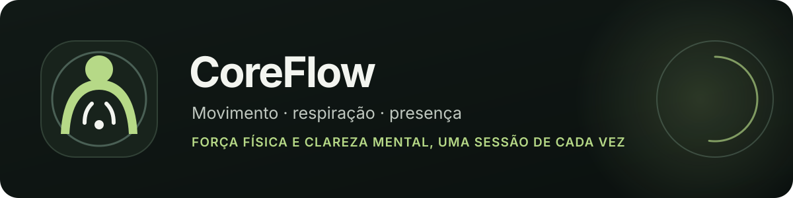
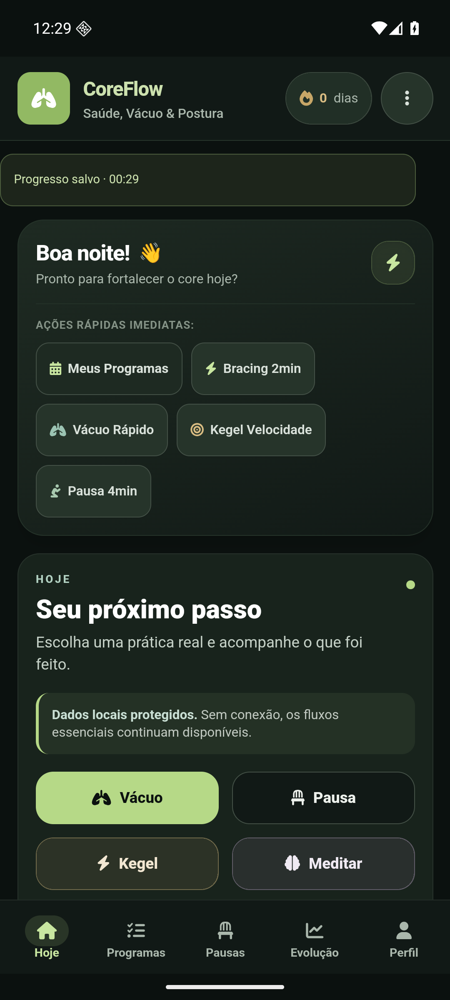
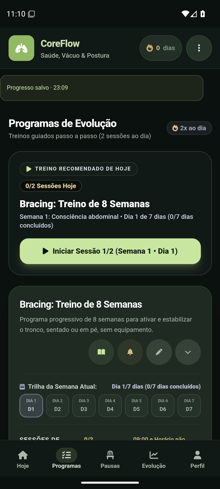
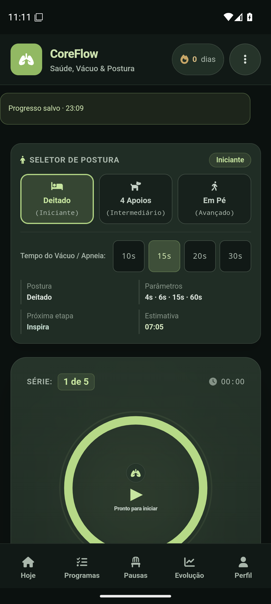
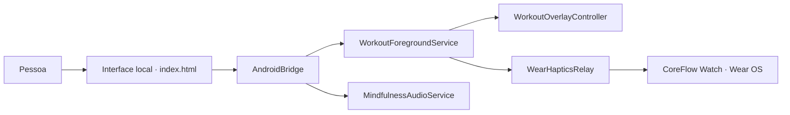

# CoreFlow

<p align="center">
  
</p>

Práticas guiadas para desenvolver força física, postura, respiração e atenção plena. O CoreFlow combina uma interface Android com recursos nativos para sessões, áudio, janela flutuante e um módulo complementar Wear OS.

<p align="center">
  
  
</p>

<details>
  <summary>Ver captura da prática de Vácuo</summary>
  <p align="center">
    
  </p>
</details>

## Índice

- [Recursos principais](#recursos-principais)
- [Versão atual](#versão-atual)
- [O que mudou na 1.1.52](#o-que-mudou-na-1152)
- [Instalar no Android](#instalar-no-android)
- [Instalar no Samsung Galaxy Watch](#instalar-no-samsung-galaxy-watch)
- [Requisitos de desenvolvimento](#requisitos-de-desenvolvimento)
- [Compilação e validação](#compilação-e-validação)
- [Arquitetura do projeto](#arquitetura-do-projeto)
- [Licença e privacidade](#licença-e-privacidade)

---

## Recursos Principais

- **Modo Treino Flutuante (Overlay Nativo):** Acompanhe e controle sua sessão ativa sobre qualquer outro aplicativo Android com janela flutuante Material 3 AMOLED (estados Mini, Compacto e Expandido, arrasto e recolhimento automático).
- **Programa de Bracing e Automação Postural (8 Semanas):** Progressão funcional do core baseada no método McGill, executável sentado em banco ou em pé.
- **Programa de Stomach Vacuum (8 Semanas):** Treino guiado com etapas de preparação, inspiração, expiração, retenção, retorno controlado e recuperação.
- **Programa de Kegel e Assoalho Pélvico (8 Semanas):** Foco em resistência, agilidade reflexa e suporte pélvico com agenda diária calibrada.
- **Programa de Mindfulness / MBCT (8 Semanas):** Oito meditações guiadas em áudio nativo com reprodução contínua em segundo plano e tela bloqueada.
- **Pausa de Resposta e Micro-Pausas Ativas:** Sessões rápidas para descompressão e alívio postural no trabalho (Alongamentos, Respiração e Pausa de Resposta), 100% integradas ao Modo Treino Flutuante nativo.
- **Sincronização com Galaxy Watch (Wear OS):** Vibrações táteis espelhadas no relógio em tempo real via Bluetooth.
- **Progresso local:** Preferências, programas e histórico de prática ficam no dispositivo. O backup Android pode incluir os dados conforme as configurações da conta e do sistema; consulte [PRIVACY.md](PRIVACY.md).

---

## Versão Atual

- **Versão atual:** `1.1.52` (`versionCode 52`)
- **Release:** direção Fluxo aprovada aplicada às práticas, sessões, diálogos e overlay flutuante. Veja [o que mudou na 1.1.52](docs/releases/v1.1.52.md).
- **Validação:** `bash scripts/check.sh` passou; as telas principais, a configuração do Vácuo e o editor do Perfil foram conferidos no emulador Android API 36. Inspeção da pílula durante uma sessão ativa, aparelho físico, TalkBack, escala de fonte 200% e Wear físico: `NOT_RUN`.
- **Downloads:** baixe os APKs assinados de celular e Wear OS na aba de [Releases](https://github.com/playertwo1/Adbm/releases/latest).
- **Histórico de Mudanças:** Consulte o [CHANGELOG.md](CHANGELOG.md) para detalhes de todas as versões.

---

## O que mudou na 1.1.52

- Hoje usa atalhos de prática PulsoIcon em largura total; as cinco abas mantêm destinos e navegação existentes.
- A direção Fluxo se estende a cards de programas e evolução, práticas, formulários, diálogos, mensagens dinâmicas e estados de sessão.
- A overlay flutuante Android usa a paleta Fluxo para os estados mini, compacto, pausado, expandido, confirmação de cancelamento e saída segura do Vácuo.
- IDs, armazenamento, histórico, exercícios, protocolos de treino, timers e integração com Galaxy Watch foram preservados.
- Referências aprovadas, atribuição/licença PulsoIcon e evidências: [registro de execução](docs/roadmap/execucao.md).

## O que mudou na 1.1.51

- Identidade visual em grafite e verde-floresta, com ações em sálvia, superfícies mais calmas e cores de apoio suavizadas.
- Paleta alinhada entre as telas Hoje, Programas, Pausas, Evolução, Perfil, Vácuo, Discreto e onboarding, além do player Compose, do overlay nativo, do ícone Android e do Wear OS.
- Editor de Perfil corrigido para abrir acima da aba transformada.
- Navegação, ordem de conteúdo, IDs de programas, dados persistidos e protocolo dos treinos preservados.
- Referências de produto e detalhes da verificação: [registro de execução](docs/roadmap/execucao.md).

## Instalar no Android

1. Baixe `app-release.apk` na página da [release mais recente](https://github.com/playertwo1/Adbm/releases/latest).
2. Abra o APK no celular e autorize a instalação para o navegador ou gerenciador de arquivos, se o Android solicitar.
3. Abra o CoreFlow. O módulo `wear-release.apk` é separado e precisa ser instalado no relógio; veja o [manual do Galaxy Watch](docs/INSTALAR-GALAXY-WATCH.md).

Instalação por APK requer Android 7.0 ou posterior. O aplicativo não é publicado pela Play Store nesta entrega.

## O que mudou na 1.1.50

Rodada de acabamento visual com a fonte do sistema em 200% e com menos caixas dentro de caixas. IDs de programas, armazenamento local e protocolo de treino não mudaram.

**Fonte grande (200%)**
- **Vácuo:** seletor de postura, tiles de fase e anel da respiração passam a quebrar linha em vez de sobrepor o texto. O anel de contração/expiração ficou menor para o texto caber.
- **Programas:** cabeçalho da aba, "Treino recomendado" e o selo "2x ao dia" quebram linha. O cabeçalho do card de programa deixa de espremer título e descrição numa coluna estreita; os ícones descem para a linha de baixo quando falta espaço, também em celulares a 100%.
- **Discreto:** seletor de modos, anéis de Resistência e Bracing, orbe de Velocidade, legenda do slider e linhas de botões cabem na tela e crescem com o texto.

**Menos cards aninhados**
- Vácuo, Pausas e Dashboard: itens internos agrupam por divisor ou filete lateral; a caixa fica só no cartão externo. Inclui os tiles de fase do Vácuo (o ativo ganha filete esmeralda), o guia da postura, as etapas e os passos da "Pausa de Resposta", o aviso de checkpoint, o adiamento personalizado e a linha Pré/Pós BPM.
- Os detalhes de Discreto e Dashboard já tinham sido achatados na rodada anterior. O detector de design passou de 17 para 2 achados de card aninhado.

**Cores**
- O botão de sessão pendente em Programas é âmbar sólido (antes gradiente âmbar→laranja; o hover tinha um erro de classe que deixava o laranja sempre ativo).
- O atalho "Pausa de Resposta" usa fundo sólido, sem o gradiente violeta/ciano.

**Treino flutuante (overlay)**
- Compacto: o contador é texto simples de 20sp, sem caixa, e deixa de parecer um botão. Pausar/Continuar e Cancelar têm o mesmo tamanho (`80 × 48 dp`), o mesmo texto (12sp) e intervalo de `8 dp`.
- Expandido: Pausar, Pular e Cancelar usam o mesmo tamanho de texto e o mesmo respiro lateral.

**Como foi validado e o que não foi**
- Cada mudança tem regressão (`diagnostics/e21` a `e25` para a interface; `WorkoutOverlayTest` para o overlay) e `bash scripts/check.sh` passou. O registro está em [docs/roadmap/execucao.md](docs/roadmap/execucao.md).
- Conferido no emulador a 100%: Vácuo, Pausas, Programas e modal de Bracing. O overlay foi conferido só por renderização em teste.
- `NOT_RUN`: overlay em aparelho em segundo plano, TalkBack, Wear OS, fonte em 200% depois dos cards achatados e erros inline do Dashboard.

## O que mudou na 1.1.49

- Na fileira compacta do treino flutuante, timer e ações têm dimensões iguais de `76 × 52 dp` e intervalos de `4 dp`.
- Pausar/Continuar usa rótulos simples e estado visual consistente; Cancelar mantém texto legível e contorno discreto.
- A opção A aprovada foi aplicada somente à fileira compacta. Outros estados do overlay aguardam avaliação visual.

## O que mudou na 1.1.48

- Pausas no trabalho são opcionais e editáveis por dia, janela e intervalo, começando desativadas. A sugestão para esta conversa é seg–sex, 8h–17h, com intervalo inicial de 60 minutos.
- A notificação abre orientações de descanso visual, mudança de posição, movimentos confortáveis, água sem meta fixa ou respiração natural. Começar uma mobilidade exige ação explícita e não cria registro de treino.
- As pílulas do treino flutuante não mudaram nesta versão; a proposta visual aguarda aprovação.

## O que mudou na 1.1.47

- Cancelamento consistente no guia e no overlay Android, imagens locais de Corpo visíveis e Respiração sincronizada ao motor nativo.

## O que mudou na 1.1.45

- Na semana 1, cada pausa entre repetições do Bracing foi reduzida de 15 para 5 segundos. A preparação inicial e as semanas seguintes mantêm seus tempos.

## Mudanças da 1.1.44

- Bracing disponível duas vezes por dia nos sete dias da semana, conforme a configuração solicitada.
- Ajuste manual de semana (1–8), dia (1–7) e sessões de hoje (0–2) restaurado. A posição escolhida permanece ao fechar e reabrir o app.
- Cada repetição continua com seu contador de exercício e descanso, sem agregar a série inteira em um único timer.
- O dia avança após as duas sessões. A revisão técnica exige o volume das duas sessões completas e preserva o limite diário ao avançar de semana.
- Pausar e retomar a mesma sessão não duplica o progresso. Mudar de semana manualmente preserva o histórico; falha ao salvar o ajuste mantém a posição e a continuação anteriores.
- IDs, dados anteriores e integração Android/Wear preservados. Homologação física e aprovação das novas pranchas seguem pendentes.

## Instalar no Samsung Galaxy Watch

O relógio recebe um APK próprio: **`wear-release.apk`**. Instalar `app-release.apk` no celular não instala automaticamente o aplicativo no Watch. O módulo Wear OS atual recebe vibrações dos exercícios iniciados no celular; ele aparece como **CoreFlow Watch**.

**[Manual completo de instalação no Galaxy Watch — Windows/PowerShell](docs/INSTALAR-GALAXY-WATCH.md)**, com preparação do relógio, comandos prontos, teste de vibração e solução de erros.

### Instalar pelo celular, sem computador

- **[Baixar Wear Installer 2 na Google Play](https://play.google.com/store/apps/details?id=org.freepoc.wearinstaller2)** — instale no celular Android.
- **[Vídeo de pareamento e instalação com Wear Installer 2](https://www.youtube.com/watch?v=abgN4jQqHb0)** — indicado pelo desenvolvedor para o pareamento no Wear OS 4 ou posterior; o vídeo usa Pixel Watch e os nomes dos menus podem variar no Galaxy Watch6.
- [Instruções escritas do desenvolvedor](https://freepoc.org/wear-installer-2-help-page/).

Com celular e relógio no mesmo Wi-Fi, ative Depuração ADB/sem fio no Watch, faça o pareamento pelo menu **Pair with watch** do Wear Installer 2 e use **Custom APK** para selecionar `wear-release.apk`, baixado nos [Assets da release](https://github.com/playertwo1/Adbm/releases/latest). Toque **Install** e desligue a depuração após concluir. A porta de pareamento e a porta de conexão são diferentes.

### Alternativa pelo computador

1. Baixe `wear-release.apk` nos [Assets da release](https://github.com/playertwo1/Adbm/releases/latest); use os APKs de celular/relógio da mesma release, com assinaturas compatíveis.
2. Conecte PC e Watch ao mesmo Wi-Fi. No relógio, ative Opções do desenvolvedor, Depuração ADB e Depuração sem fio.
3. Faça `adb pair IP:PORTA_DE_PAREAMENTO` usando a tela com código; depois `adb connect IP:PORTA_DE_CONEXAO` usando a página principal de Depuração sem fio. **As portas geralmente são diferentes.**
4. Instale com `adb -s IP:PORTA_DE_CONEXAO install -r "CAMINHO_DO_WEAR_APK"` e aguarde `Success`; substitua os valores pelos reais.
5. Abra CoreFlow Watch; com Galaxy Wearable/Bluetooth conectado, ative **Galaxy Watch** no CoreFlow do celular e teste a vibração. Desative a depuração ao terminar.

Compatível com o módulo Wear OS API 30+ (Galaxy Watch4 e posteriores com Wear OS); relógios antigos com Tizen não executam este APK. A indicação “pronta” no Watch não comprova conexão. Homologação física continua pendente.

## Requisitos de Desenvolvimento

- **Android Studio** com JBR integrado e Android SDK; o Gradle do projeto requer JDK 17 ou posterior compatível.
- **Android SDK:** Compile SDK 36, Target SDK 36, Min SDK 24 (Android 7.0+).
- **Gradle:** 9.3.1.
- **Wear OS:** Android 11+ (API 30+) para o módulo complementar `wear/` (Galaxy Watch4 ou mais recente).
- **Node.js:** v18+ para execução das suítes de diagnóstico e testes de regressão.

---

## Compilação e Validação

Antes de validar ou compilar, configure `JAVA_HOME` para o JDK do Android Studio e `ANDROID_HOME` para o Android SDK:

```bash
# Executa regressões Node, confirmação de integridade HTML e compilação debug
bash scripts/check.sh
```

### Compilar APK de Desenvolvimento (Debug):
```powershell
.\gradlew.bat :app:assembleDebug :wear:assembleDebug
```

### Compilar APK de Produção (Release Assinado):
Configure as credenciais de assinatura persistente e execute:

```powershell
$env:KEYSTORE_PATH = "caminho/para/coreflow-upload.jks"
$env:KEYSTORE_PASSWORD = "sua_senha_keystore"
$env:KEY_ALIAS = "seu_alias"
$env:KEY_PASSWORD = "sua_senha_chave"
$env:BUILD_VERSION_CODE = "52"
$env:BUILD_VERSION_NAME = "1.1.52"

.\gradlew.bat :app:assembleRelease :wear:assembleRelease
```

Os pacotes gerados ficam localizados em:
- Celular: `app/build/outputs/apk/release/app-release.apk`
- Relógio: `wear/build/outputs/apk/release/wear-release.apk`

---

## Arquitetura do Projeto

- `index.html`: interface de treino e fonte de verdade da lógica web.
- `app/src/main/assets/index.html`: cópia embarcada idêntica byte a byte.
- `app/src/main/java/com/example/MainActivity.kt`: hospeda a WebView local e contém a bridge JavaScript para os recursos nativos.
- `WorkoutForegroundService.kt`, `WorkoutOverlayController.kt` e `MindfulnessAudioService.kt`: controlam sessão, janela flutuante e áudio em primeiro plano.
- `WearHapticsRelay.kt` e `wear/`: enviam padrões táteis ao módulo Wear OS.
- `ROADMAP.md`: Planejamento ativo e backlog de desenvolvimento do projeto.
- `docs/arquivados/roadmap-etapas-concluidas.md`: Histórico e critérios de aceite das etapas concluídas.



---

## Licença e Privacidade

- Consulte [PRIVACY.md](PRIVACY.md) para a política de retenção local de dados.
- Consulte [SIGNING.md](SIGNING.md) para diretrizes de assinatura criptográfica contínua.
- Todos os direitos reservados.
