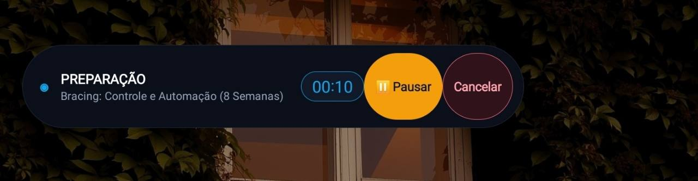
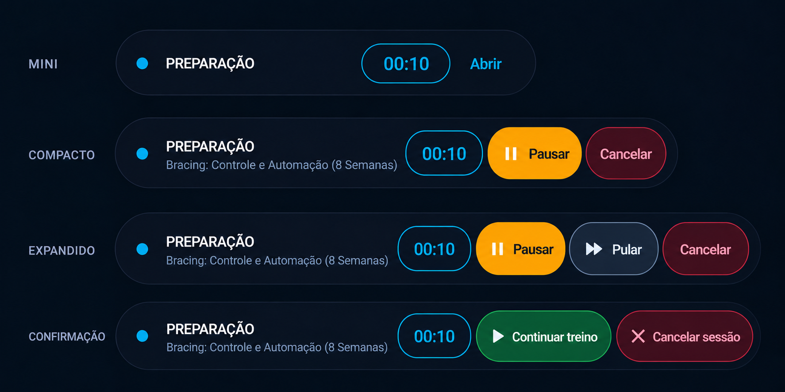
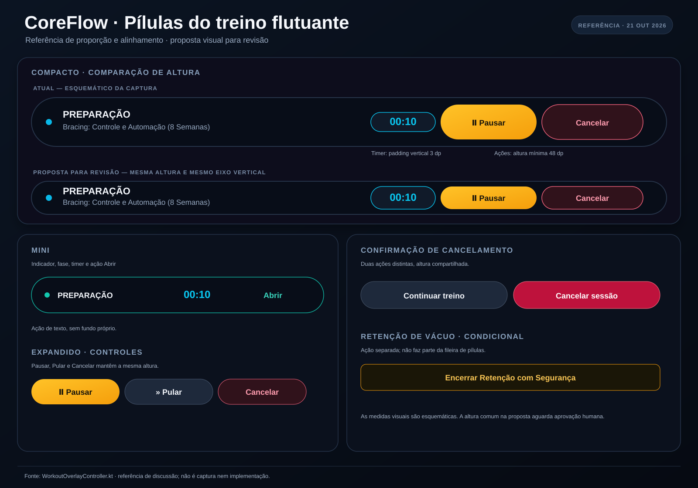
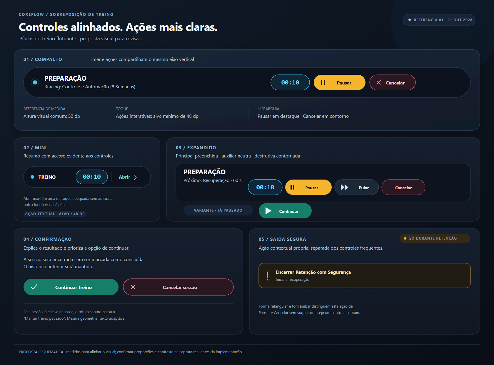

# Referências visuais — pílulas do treino flutuante

## O que está mapeado

- **Mini:** indicador/fase, temporizador e ação `Abrir`.
- **Compacto:** indicador/fase, nome do programa, temporizador, `Pausar` e `Cancelar`.
- **Expandido:** temporizador e ações `Pausar`, `Pular` e `Cancelar`.
- **Confirmação:** ações `Continuar treino` e `Cancelar sessão`.
- **Condicional:** `Encerrar Retenção com Segurança`, exibido durante retenção de vácuo.

## Leitura da captura

No modo compacto, o temporizador recebe apenas 3 dp de padding vertical, enquanto `Pausar` e `Cancelar` têm altura mínima de 48 dp. Essa diferença no `WorkoutOverlayController.kt` corresponde ao desalinhamento visível na captura.

A segunda imagem é uma exploração visual gerada para discutir cor e hierarquia; não use a imagem gerada como medida exata. O mapa vetorial separa a diferença atual da proposta de altura comum. Ele também é uma referência para revisão, não captura nem implementação, e precisa de aprovação humana antes de virar contrato visual.

## Proposta refinada

Fonte vetorial editável: [04-prancha-refinada.svg](./04-prancha-refinada.svg). O mapa inicial permanece em [03-mapa-pilulas-alinhadas.svg](./03-mapa-pilulas-alinhadas.svg) para comparação.

## Critérios de mercado aplicados

- Timer e botões da mesma fileira compartilham centro e altura visual proposta de 52 dp; cada ação interativa mantém alvo de pelo menos 48 dp.
- Uma ação principal preenchida, ação auxiliar neutra e ação destrutiva contornada deixam a hierarquia mais clara. O timer permanece informativo, sem aparência de botão.
- A ação especial de segurança tem tratamento próprio e separado dos controles frequentes. “Abrir” continua textual, com área de toque ampliada.
- A paleta repete cores semânticas e mantém alto contraste aparente; a razão precisa ser medida na tela final e sobre os fundos reais.

Os critérios vieram das fontes oficiais do [Android para alvos de toque](https://developer.android.com/guide/topics/ui/accessibility/views/apps-views?hl=en), da [acessibilidade visual Android](https://developer.android.com/design/ui/mobile/guides/foundations/accessibility?authuser=8), da separação entre [componentes de ação e seleção no Material](https://developer.android.com/design/ui/mobile/guides/components/material-overview?hl=en) e do [uso de cores no Android](https://developer.android.com/design/ui/mobile/guides/styles/color?authuser=39).

A prancha cobre mini, compacto, expandido, o estado pausado, os dois rótulos possíveis na confirmação e a saída segura condicional. É uma proposta esquemática, não uma captura nem uma implementação: proporções, contraste e comportamento responsivo precisam de revisão humana em captura real.
